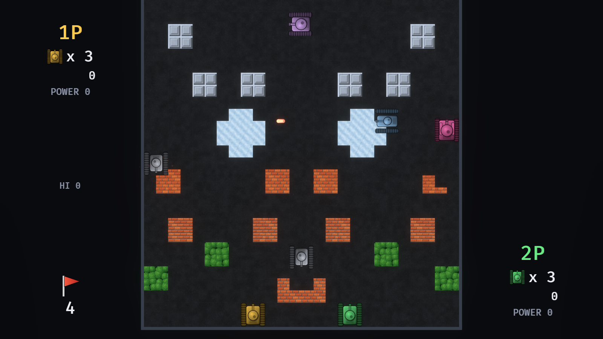

# Battle Tanks


Two-player couch tank game: defend your base, clear 20 enemy tanks per stage across 30 stages. Or play **City Run**: ten long scrolling districts with fortress gates, mini-bosses and a boss at the end of each. Built with Rust + [Bevy](https://bevy.org/).
Made for playing on a TV with two controllers; two people can also share a keyboard.

| | |
|---|---|
|  |  |
|  |  |

## Download

Grab `BattleTanks.exe` from the [latest release](https://github.com/Lunat1q/BattleTanks/releases/latest) — it's the whole game.

## Build

Requires Rust (stable). From the repo root:

```sh
cargo build --release
```

The game is a single file: `target/release/battle_tanks.exe` (no asset folder needed — art and sound are generated).
Copy it anywhere you like, e.g. `C:\Games\BattleTanks\battle_tanks.exe`.

## Add to Steam (non-Steam game)

1. Steam → **Games → Add a Non-Steam Game to My Library… → Browse…** → pick `battle_tanks.exe` → **Add Selected Programs**.
2. Optional: right-click it → **Properties** → rename to "Battle Tanks". For library artwork, right-click the
   game's tile / banner / logo in the library → **Manage → Set custom artwork** and pick the images in
   [`docs/steam/`](docs/steam): `capsule-600x900.png` (grid), `capsule-920x430.png` (wide), `hero-3840x1240.png`
   (background), `logo-1280x200.png` (logo), `icon-256.png` (icon).
3. If a controller shows up twice or moves the menu double, right-click → **Properties → Controller** →
   *Disable Steam Input* for this game.

It now appears in Steam's library, so Sunshine/Vibepollo's Steam app (Big Picture) and the Moonlight client on the
TV can launch it. The game starts borderless fullscreen with the mouse cursor hidden.

## Controls

| | Controller | Keyboard P1 | Keyboard P2 |
|---|---|---|---|
| Join / fire / confirm | A | Space | Enter |
| Move | D-pad or left stick | WASD | Arrows |
| Back / leave | B | Backspace | Backspace |
| Pause | Start | Esc | Esc |

**SETTINGS** on the title screen: FPS limit (default 60), VSync, fullscreen, sound and music volume, screen shake, FPS counter, friendly fire, controller vibration and keep power (stars survive losing a tank), saved to `%APPDATA%\BattleTanks\settings.txt`.

Out of tanks while your partner still has spares? Press **A** to borrow one.

## Scores

Kills, power-ups and speed score: each classic stage cleared quicker than its par time (about two minutes over the
fastest possible clear) adds a time bonus. Your best score is kept between sessions. At game over in classic mode you
can enter a name (up to 7 letters) and send the run to the **world board** (top 100 for one and two players):
<https://scores.maxpodolski.com>. **B** skips it.

Quit from the title (**EXIT**) or the pause menu (**EXIT GAME**). `F11` / `Alt+Enter` toggles fullscreen;
`--windowed` starts in a window. Set `BT_MUTE=1` to start without sound.

## Privacy

Battle Tanks has no accounts, ads or analytics. Settings, City Run progress and your best score are saved only on
your device (`%APPDATA%\BattleTanks` on Windows, the app's private storage elsewhere) and are deleted with the game. On Android, if you are signed in to Google Play Games, City Run unlocks are also kept
as a Play Games saved game on your Google account, so your other devices get them; nothing else goes there.

The game connects to the internet only for the world board. Opening HI SCORES reads the public board and sends
nothing about you. When you choose to send a run, at game over or after a City Run district, it sends the name you
entered (up to 7 letters), the run's stage log (stage numbers, times, kills, power-ups, score) and the game version to
`scores.maxpodolski.com`. Each board keeps its top 100 runs (name, score, stages cleared, date) and shows them
publicly; your IP address is used only to limit how often scores arrive and is not stored. Press **B** at the name
entry and nothing is sent. LAN CO-OP talks only to the other device you join, on your local network: while its screen is open the host
announces its device name (e.g. the phone's name) on the network so the other player can find it, and during play the
two devices exchange the players' controller input and game state. Nothing from LAN CO-OP is sent to the internet
or kept. Where a build asks for Bluetooth ("nearby devices") access,
it is used only to talk to a controller you have paired; no data leaves the device.
Questions: open an issue on this repository.

## License

[PolyForm Noncommercial 1.0.0](LICENSE.md): free for personal, hobby and other noncommercial use; commercial use needs permission.
