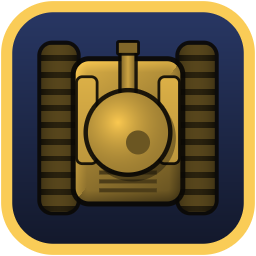
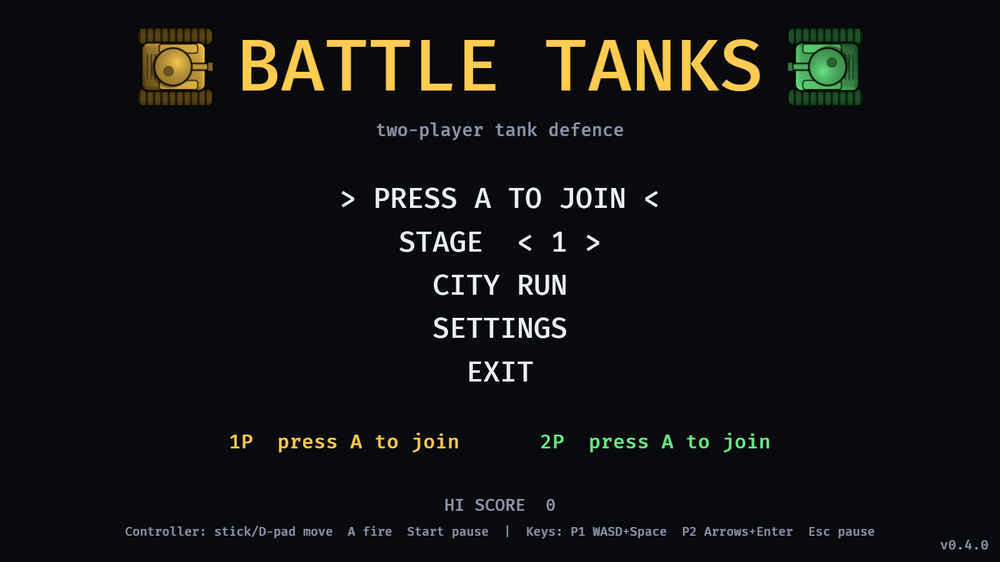
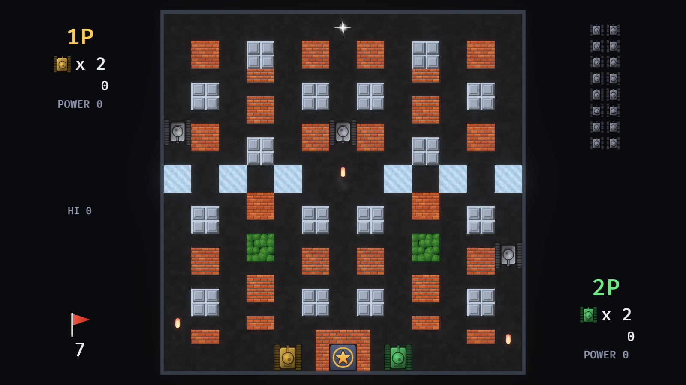
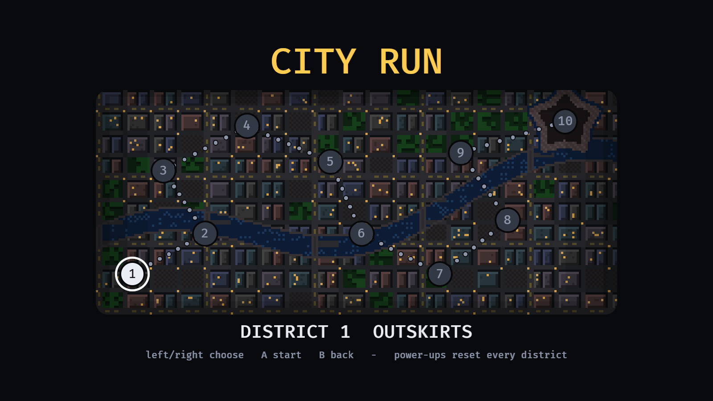

# Battle Tanks



Two-player couch tank game: defend your base, clear 20 enemy tanks per stage across 30 stages. Or play **City Run**: ten long scrolling districts with fortress gates, mini-bosses and a boss at the end of each. Built with Rust + [Bevy](https://bevy.org/).
Made for playing on a TV with two controllers; two people can also share a keyboard.

| | |
|---|---|
|  |  |
|  |  |

## Download

Grab `BattleTanks.exe` from the [latest release](https://github.com/Lunat1q/BattleTanks/releases/latest) — it's the whole game.

## Build

Requires Rust (stable). From the repo root:

```sh
cargo build --release
```

The game is a single file: `target/release/battle_tanks.exe` (no asset folder needed — art and sound are generated).
Copy it anywhere you like, e.g. `C:\Games\BattleTanks\battle_tanks.exe`.

## Add to Steam (non-Steam game)

1. Steam → **Games → Add a Non-Steam Game to My Library… → Browse…** → pick `battle_tanks.exe` → **Add Selected Programs**.
2. Optional: right-click it → **Properties** → rename to "Battle Tanks", set artwork.
3. If a controller shows up twice or moves the menu double, right-click → **Properties → Controller** →
   *Disable Steam Input* for this game.

It now appears in Steam's library, so Sunshine/Vibepollo's Steam app (Big Picture) and the Moonlight client on the
TV can launch it. The game starts borderless fullscreen with the mouse cursor hidden.

## Controls

| | Controller | Keyboard P1 | Keyboard P2 |
|---|---|---|---|
| Join / fire / confirm | A | Space | Enter |
| Move | D-pad or left stick | WASD | Arrows |
| Back / leave | B | Backspace | Backspace |
| Pause | Start | Esc | Esc |

**SETTINGS** on the title screen: FPS limit (default 60), VSync, fullscreen, sound and music volume, screen shake, FPS counter, friendly fire, controller vibration and keep power (stars survive losing a tank), saved to `%APPDATA%\BattleTanks\settings.txt`.

Out of tanks while your partner still has spares? Press **A** to borrow one.

Quit from the title (**EXIT**) or the pause menu (**EXIT GAME**). `F11` / `Alt+Enter` toggles fullscreen;
`--windowed` starts in a window. Set `BT_MUTE=1` to start without sound.

## License

[PolyForm Noncommercial 1.0.0](LICENSE.md): free for personal, hobby and other noncommercial use; commercial use needs permission.
